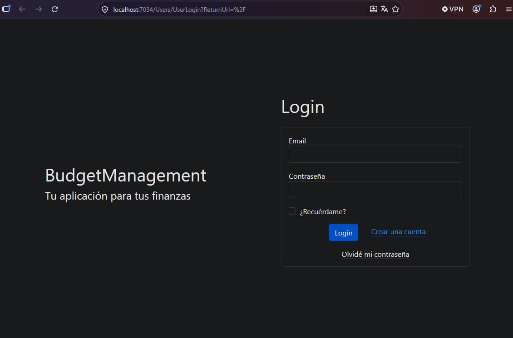

# 💰 BudgetManagement

A personal budget management web application built with **ASP.NET Core MVC** and **SQL Server**, designed to help users to track accounts, transactions, and financial categories in an organized way.

---

## 📋 Table of Contents

- [Overview](#-overview)
- [Features](#-features)
- [Tech Stack](#️-tech-stack)
- [Database Schema](#️-database-schema)
- [Getting Started](#-getting-started)
  - [Prerequisites](#prerequisites)
  - [Installation](#installation)
  - [Database Setup](#database-setup)
- [Project Structure](#-project-structure)
  - [Directory Overview](#-directory-overview)
- [Usage](#-usage)
- [API / Controllers](#-api--controllers)
- [Roadmap](#️-roadmap)

---

## 📌 Overview

BudgetManagement is a full-stack budget tracking application that allows users to manage their personal finances. Users can create account types (e.g. savings, credit cards, loans), manage accounts, log transactions, and organize spending by category. This would be the database system managing all relevant information related to budgets, users, reporting, accounts, among others.

---

## 🎬 Application Preview

Here's a quick demonstration of the BudgetManagement application and its main functionalities.

<div align="center">
    
</div>

---

## ✨ Features

- 🗂️ **Account Types** — Group accounts by category (e.g. loans, credit cards, cash)
- 🏦 **Accounts** — Create and manage individual financial accounts
- 💸 **Transactions** — Record income and expenses with date and description
- 🏷️ **Categories** — Classify transactions for better financial insight
- 🔃 **Drag & Drop Ordering** — Reorder account types interactively via jQuery UI Sortable
- 📊 **Dashboard** — Overview of your financial summary
- ✏️ **Full CRUD** — Create, read, update, and delete for all entities

---

## 🛠️ Tech Stack

| Layer | Technology |
|---|---|
| Framework | ASP.NET Core MVC (.NET 10) |
| Language | C# |
| ORM / Data Access | Dapper |
| Database | SQL Server |
| Frontend | Razor Views, Bootstrap 5 |
| JavaScript | jQuery, jQuery UI |
| HTTP Requests | Fetch API (AJAX) |
| IDE | Visual Studio / VS Code |

---

## 🗄️ Database Schema

Key tables used in the application and columns:

```
TABLES

[dbo].[account_types]      (account_type_id, account_type_name, user_id, user_order)
[dbo].[budget_account]     (account_id, account_name, account_type_id, account_balance, description)
[dbo].[category]           (category_id, category_name, operation_type_id, user_id)
[dbo].[transactions]       (transaction_id, user_id, transacction_date, amount, notes, account_id, category_id)
[dbo].[operation_type]     (operation_type_id, description)
[dbo].[users]              (user_id, email, standard_email, password_hash)

----------------------------------------------------------------------------------------------------

PRIMARY KEYS

[dbo].[account_types]      {account_type_id}
[dbo].[budget_account]     {account_id}
[dbo].[category]           {category_id}
[dbo].[transactions]       {transaction_id}
[dbo].[operation_type]     {operation_type_id}
[dbo].[users]              {user_id}

----------------------------------------------------------------------------------------------------

FOREIGN KEYS

[dbo].[account_types]      {user_id}
[dbo].[budget_account]     {account_type_id}
[dbo].[category]           {operation_type_id} {user_id}
[dbo].[transactions]       {user_id} {account_id} {category_id}
```

> Relationships are enforced via Foreign Key constraints in SQL Server.

---

## 🌟 Getting Started

### Prerequisites

- [.NET SDK 7.0+](https://dotnet.microsoft.com/download)
- [SQL Server](https://www.microsoft.com/en-us/sql-server/sql-server-downloads) (or SQL Server Express)
- [SQL Server Management Studio (SSMS)](https://learn.microsoft.com/en-us/sql/ssms/download-sql-server-management-studio-ssms) *(optional)*
- [Visual Studio 2022 or above](https://visualstudio.microsoft.com/) or [VS Code](https://code.visualstudio.com/)

### Installation

1. **Clone the repository**
   ```bash
   git clone https://github.com/sebasflores10/budgetmanagement.git
   ```

2. **Restore dependencies**
   ```bash
   dotnet restore
   ```

3. **Configure the connection string** in `appsettings.json`:
   ```json
   {
     "ConnectionStrings": {
       "DefaultConnection": "Server=YOUR_SERVER;Database=ManejoPresupuestos;Trusted_Connection=True;TrustServerCertificate=True;"
     }
   }
   ```

4. **Run the application**
   ```bash
   dotnet run
   ```

### Database Setup

1. Open SSMS and connect to your SQL Server instance.
2. Run the SQL scripts located in `/Database/` directory in the following order:
   - `BudgetManagement_CreateTables.sql`

---

## 📁 Project Structure

```
BudgetManagement/
│
├── Controllers/
│   ├── AccountTypeController.cs
│   ├── BudgetAccountController.cs
│   ├── CategoryController.cs
│   ├── HomeController.cs
│   ├── TransactionsController.cs
│   └── UsersController.cs
│
├── Models/
│   ├── Data/
│   │   ├── AccountType.cs
│   │   ├── BudgetAccount.cs
│   │   ├── Category.cs
│   │   ├── Transactions.cs
│   │   └── User.cs
│   │
│   ├── Entities/
│   │   ├── FullCalendarEvent.cs
│   │   ├── GetTransactionsByBudgetAccount.cs
│   │   ├── GetUserTransactionsRequest.cs
│   │   ├── MonthlyResultSQL.cs
│   │   ├── TransactionsResultByWeek.cs
│   │   ├── TransactionsDashboard.cs
│   │   └── TransactionsSubmenu.cs
│   │
│   ├── Enums/
│   │   └── OperationType.cs
│   │
│   └── ViewModels/
│       ├── AmmountSummaryViewModel.cs
│       ├── BudgetAccountCreateViewModel.cs
│       ├── BudgetAccountIndexViewModel.cs
│       ├── ErrorViewModel.cs
│       ├── ForgotPasswordViewModel.cs
│       ├── MonthlyReportViewModel.cs
│       ├── PaginationResponseViewModel.cs
│       ├── PaginationViewModel.cs
│       ├── PasswordResetViewModel.cs
│       ├── RegisterUserViewModel.cs
│       ├── TransactionsCreateViewModel.cs
│       ├── UpdateTransactionsViewModel.cs
│       ├── UserLoginViewModel.cs
│       └── WeeklyReportViewModel.cs
│
├── Properties/
│   └── launchSettings.json
│
├── Services/
│   ├── AccountTypeRepository.cs
│   ├── AutoMapperProfiles.cs
│   ├── BudgetAccountRepository.cs
│   ├── CalendarRepository.cs
│   ├── CategoryRepository.cs
│   ├── ForgotPassword.cs
│   ├── ReportService.cs
│   ├── TransactionsRepository.cs
│   ├── TranslateIdentityErrorsToSpanish.cs
│   ├── UserRepository.cs
│   ├── UserService.cs
│   └── UserStore.cs
│
├── Validations/
│   └── FirstCapitalWordAttrubute.cs
│
├── Views/
│   ├── AccountType/
│   │   ├── CreateAccountType.cshtml
│   │   ├── DeleteAccountType.cshtml
│   │   ├── EditAccountType.cshtml
│   │   └── Index.cshtml
│   │
│   ├── BudgetAccount/
│   │   ├── BudgetAccountDashboard.cshtml
│   │   ├── CreateBudgetAccount.cshtml
│   │   ├── DeleteBudgetAccount.cshtml
│   │   ├── EditBudgetAccount.cshtml
│   │   ├── Index.cshtml
│   │   └── Index.cshtml.css
│   │
│   ├── Category/
│   │   ├── CreateCategory.cshtml
│   │   ├── DeleteCategory.cshtml
│   │   ├── EditCategory.cshtml
│   │   └── Index.cshtml
│   │
│   ├── Home/
│   │   ├── Index.cshtml
│   │   ├── NotFound.cshtml
│   │   └── Privacy.cshtml
│   │
│   ├── Shared/
│   │   ├── _AmmountSummary.cshtml
│   │   ├── _DetailedTransactionsReport.cshtml
│   │   ├── _Layout.cshtml
│   │   ├── _Layout.cshtml.css
│   │   ├── _LinksUserLogin.cshtml
│   │   ├── _MonthNav.cshtml
│   │   ├── _Pagination.cshtml
│   │   ├── _ValidationScriptsPartial.cshtml
│   │   └── _Error.cshtml
│   │
│   ├── Transactions/
│   │   ├── _Submenu.cshtml
│   │   ├── Calendar.cshtml
│   │   ├── CreateTransaction.cshtml
│   │   ├── DeleteTransaction.cshtml
│   │   ├── ExcelReport.cshtml
│   │   ├── Index.cshtml
│   │   ├── Monthly.cshtml
│   │   ├── UpdateTransaction.cshtml
│   │   └── Weekly.cshtml
│   │
│   ├── Users/
│   │   ├── _Layout.cshtml
│   │   ├── ForgotPassword.cshtml
│   │   ├── PasswordChange.cshtml
│   │   ├── RegisterUser.cshtml
│   │   ├── ResetPassword.cshtml
│   │   └── UserLogin.cshtml
│   │
│   ├── _ViewImports.cshtml
│   └── _ViewStart.cshtml
│
├── wwwroot/
│   ├── css/
│   │   ├── custom.css
│   │   └── site.css
│   │
│   ├── js/
│   │   ├── site.js
│   │   └── TransactionsForms.js
│   │
│   ├── lib/
│   │   ├── bootstrap/
│   │   ├── fullcalendar-7.0.2/
│   │   ├── jquery/
│   │   ├── jquery-ui-1.14.2/
│   │   ├── jquery-validation/
│   │   └── jquery-validation-unobstrusive/
│   │
│   └── favicon.ico
│
├── .dockerignore
├── .gitignore
├── BudgetManagement.csproj
├── BudgetManagement.slnx
├── Dockerfile
├── Program.cs
├── README.md
├── appsettings.Development.json
├── appsettings.json
└── libman.json
```
---

### 📂 Directory Overview

| Directory            | Description                                                                                                                                               |
| -------------------- | --------------------------------------------------------------------------------------------------------------------------------------------------------- |
| `Controllers/`       | Contains MVC controllers responsible for handling HTTP requests, application flow, and communication between the views and application services.          |
| `Models/Data/`       | Contains the primary data models representing the application's core objects, such as users, accounts, categories, and transactions.                      |
| `Models/Entities/`   | Contains specialized entities and data structures used for reports, database queries, dashboards, calendars, and other application features.              |
| `Models/Enums/`      | Contains enumerations used throughout the application.                                                                                                    |
| `Models/ViewModels/` | Contains ViewModels designed specifically to transfer data between controllers and Razor views.                                                           |
| `Properties/`        | Contains development and application launch configuration.                                                                                                |
| `Services/`          | Contains repositories and application services responsible for data access, business logic, user management, reporting, and other reusable functionality. |
| `Validations/`       | Contains custom validation attributes and validation-related functionality.                                                                               |
| `Views/`             | Contains the Razor `.cshtml` files responsible for rendering the application's user interface.                                                            |
| `wwwroot/`           | Contains static client-side resources such as CSS, JavaScript, third-party libraries, and the application favicon.                                        |


---
---

## 📖 Usage

Once the app is running, navigate to `https://localhost:7136` and:

1. **Create Account Types** — Define how you want to group your accounts.
2. **Add Budget Accounts** — Assign each account to an account type.
2. **Add Categories** — Assign each account to a category of an account type.
3. **Log Transactions** — Record your income and expenses.
4. **Explore the Dashboard** — View a summary of your financial activity.

> You can drag and drop rows in the Account Types table to reorder them. The order is saved automatically via an AJAX call to the backend.

---

## 🔌 API / Controllers

| Method | Route | Description |
|---|---|---|
| GET | `/AccountType` | List all account types |
| GET | `/AccountType/Create` | Create form |
| POST | `/AccountType/Create` | Save new account type |
| GET | `/AccountType/EditAccountType/{id}` | Edit form |
| POST | `/AccountType/EditAccountType/{id}` | Update account type |
| GET | `/AccountType/DeleteAccountType/{id}` | Delete confirmation |
| POST | `/AccountType/DeleteAccountType/{id}` | Delete account type |
| POST | `/AccountType/TableOrder` | Update sort order (AJAX) |

---

> Same pattern applicable to all other tables: [dbo].[account_types], [dbo].[budget_account], [dbo].[category], [dbo].[operation_type], [dbo].[transactions] & [dbo].[users]

## 🗺️ Roadmap

- [ ] User authentication & registration
- [ ] Monthly budget reports
- [ ] Chart visualizations (income vs. expenses)
- [ ] Export transactions to CSV
- [ ] Mobile-responsive improvements
- [ ] Dark mode

---